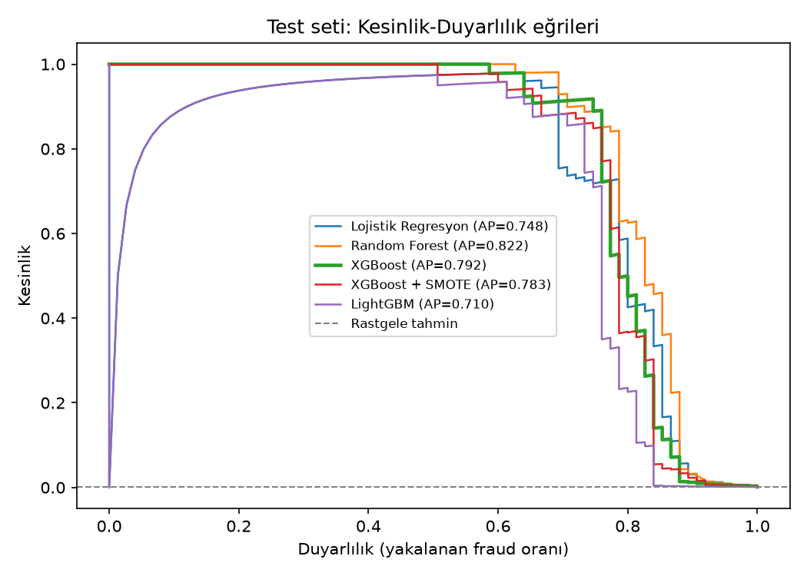
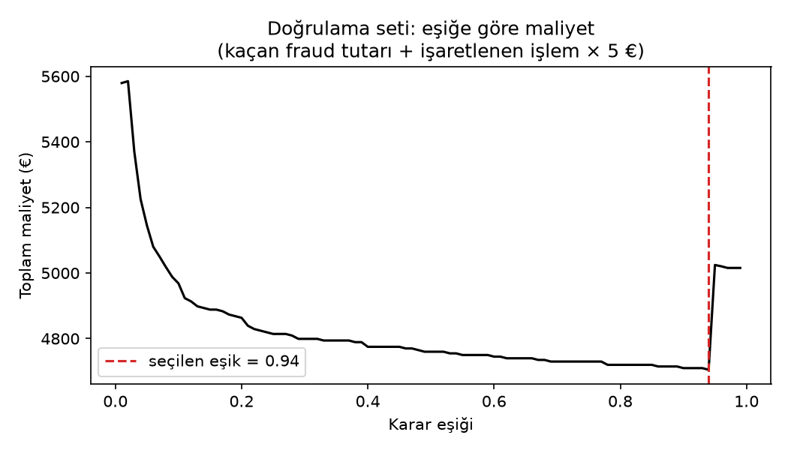
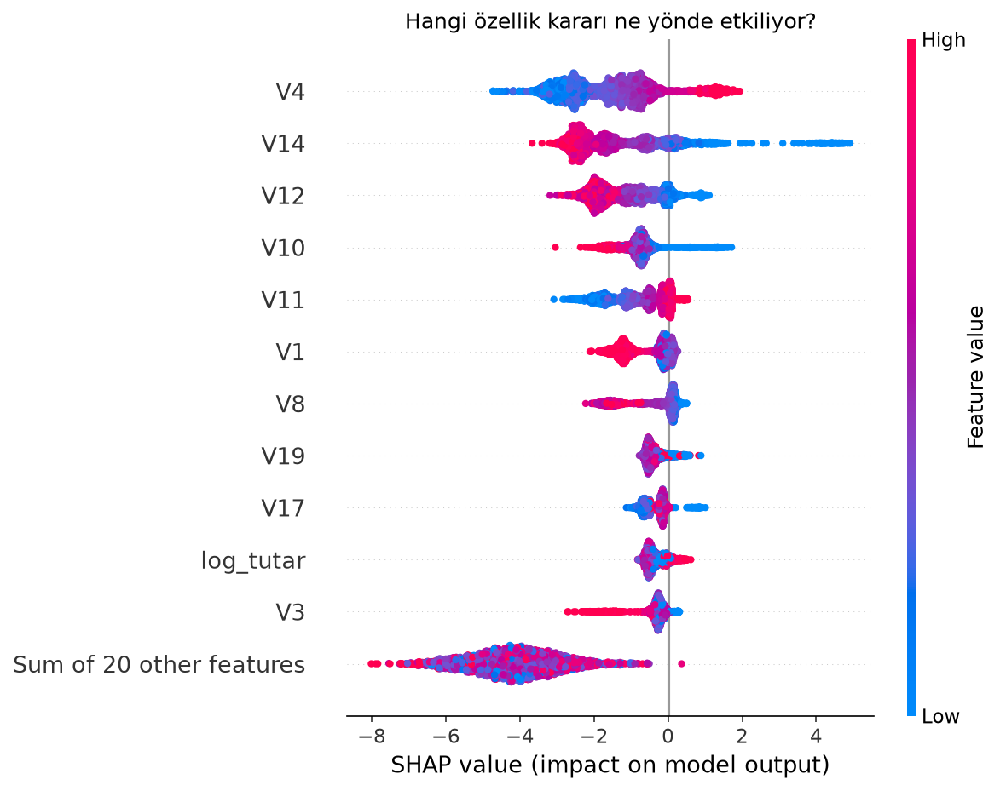
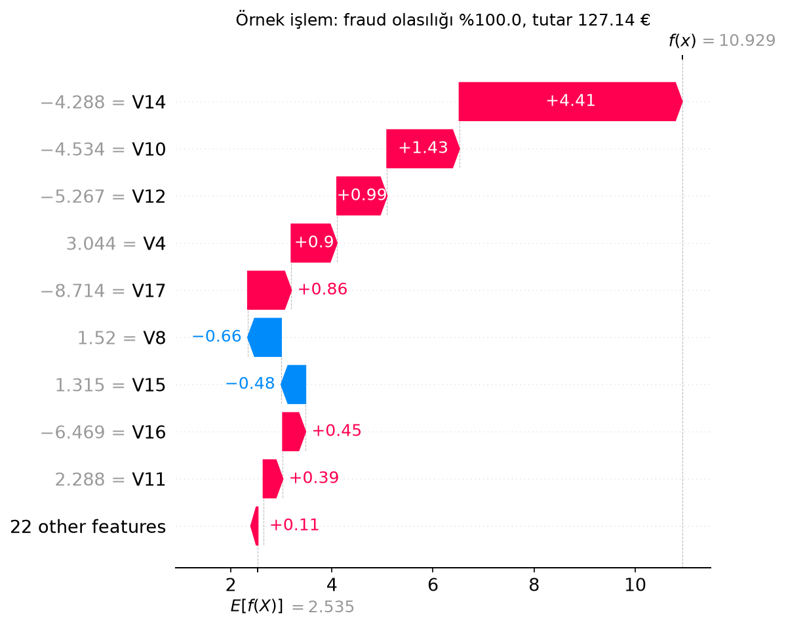

# Kredi Kartı Fraud Tespiti

Avrupalı kart sahiplerinin iki günlük 284.807 işleminde (492'si fraud, %0,17) sahtekarlık tespiti.
Proje "Veri Bilimi için İstatistik" dersi için lojistik regresyon ve istatistiksel testlerle başladı,
sonra şu adımlarla genişletildi:

- Zamana göre eğitim / doğrulama / test bölmesi (rastgele bölme yerine)
- 5 model karşılaştırması: Lojistik Regresyon, Random Forest, XGBoost, XGBoost + SMOTE, LightGBM
- Doğruluk yerine PR-AUC ile değerlendirme, bootstrap ile %95 güven aralıkları
- Karar eşiğini maliyete göre seçme (kaçan fraud tutarı + inceleme maliyeti)
- SHAP ile model kararlarının açıklanması
- FastAPI servisi (her tahminle birlikte en etkili 3 özellik), testler ve Dockerfile

## Sonuçlar

### Model karşılaştırması

İlk %60 işlem eğitim, sonraki %20 doğrulama, son %20 test. Model seçimi ve eşik doğrulama setinde yapıldı,
test seti yalnızca en sonda kullanıldı.

| Model | Doğrulama PR-AUC | Test PR-AUC | Eğitim süresi |
| --- | --- | --- | --- |
| **XGBoost** (seçilen) | **0,784** | 0,792 | 2 sn |
| Random Forest | 0,762 | 0,822 | 14 sn |
| Lojistik Regresyon | 0,757 | 0,748 | 0,3 sn |
| XGBoost + SMOTE | 0,748 | 0,783 | 2 sn |
| LightGBM | 0,742 | 0,710 | 1 sn |

Random Forest testte daha yüksek çıktı ama seçimi test sonucuna bakarak değiştirmedim; doğrulama setinde XGBoost öndeydi.
Test setinde 75 fraud olduğu için bu farklar güven aralıklarının içinde kalıyor.
SMOTE, sınıf ağırlığı kullanmaya göre bir şey kazandırmadı.

### Seçilen model (XGBoost, eşik 0,94, test seti)

| Ölçüt | Değer | %95 güven aralığı |
| --- | --- | --- |
| PR-AUC | 0,792 | 0,695 – 0,871 |
| ROC-AUC | 0,977 | |
| Kesinlik | 0,903 | |
| Duyarlılık | 0,747 | 0,645 – 0,840 |
| F1 | 0,818 | |



### Para olarak

Test dönemindeki (son yaklaşık 8 saat) 56.962 işlemde 75 fraud var, toplam tutarları 7.729 €.
Şüpheli bulunan her işlemin bir analist tarafından incelendiğini ve bunun işlem başına 5 € tuttuğunu varsaydım.

- Model 62 işlemi işaretledi, bunların 56'sı gerçekten fraud.
- Yakalanan fraud tutarı 4.095 €, inceleme maliyeti 310 €.
- Hiç model kullanmamaya göre net kazanç **3.785 €**, yani fraud kaybının yaklaşık yarısı.

Eşik, doğrulama setinde toplam maliyeti en düşük yapan değer olarak seçildi:



İnceleme maliyeti değişince eşik de değişiyor (doğrulamada seçilip testte ölçüldü):

| İnceleme maliyeti | Eşik | Test duyarlılığı | İşaretlenen işlem | Net kazanç |
| --- | --- | --- | --- | --- |
| 1 € | 0,01 | 0,84 | 395 | 4.973 € |
| 5 € | 0,94 | 0,75 | 62 | 3.785 € |
| 10 € | 0,94 | 0,75 | 62 | 3.475 € |
| 25 € | 0,94 | 0,75 | 62 | 2.545 € |

### İlk sürümle karşılaştırma

Ders projesindeki lojistik regresyon %97,5 doğruluk alıyordu, ama bu veri setinde her işleme "normal" demek bile %99,8 doğruluk veriyor.
O model 1.530 işlemi işaretleyip 90 fraud yakalıyordu, yani alarmların %94'ü yanlıştı.
Bu yüzden yeni sürümde doğruluğa bakmıyorum, PR-AUC ve maliyet üzerinden değerlendiriyorum.

### Model neye bakıyor? (SHAP)



En etkili özellikler V4, V14, V12, V10 ve V11. V14, V12 ve V10'un düşük, V4'ün yüksek değerleri fraud olasılığını artırıyor.
Tek bir işlem için açıklama:



## API

```bash
uvicorn api.app:app --reload
```

`http://127.0.0.1:8000/docs` adresinde tüm uç noktalar denenebilir.

| Uç nokta | Açıklama |
| --- | --- |
| `GET /saglik` | Servis durumu, model adı ve eşik |
| `POST /tahmin` | Tek işlem |
| `POST /toplu-tahmin` | İşlem listesi |

Girdi, veri setindeki ham sütunlar: `Time`, `Amount`, `V1`…`V28`. Örnek cevap:

```json
{
  "olasilik": 0.9999,
  "supheli": true,
  "esik": 0.94,
  "nedenler": [
    {"ozellik": "V14", "etki": 4.524},
    {"ozellik": "V10", "etki": 1.315},
    {"ozellik": "V4", "etki": 1.213}
  ]
}
```

Docker ile:

```bash
docker build -t fraud-api .
docker run -p 8000:8000 fraud-api
```

## Çalıştırma

```bash
python -m venv .venv
.venv\Scripts\activate          # Linux/macOS: source .venv/bin/activate
pip install -r requirements.txt
```

[Kaggle'dan](https://www.kaggle.com/datasets/mlg-ulb/creditcardfraud) `creditcard.csv` dosyasını indirip `data/` klasörüne koyun.

```bash
python -m src.egit      # modelleri eğitir, models/ ve reports/ altına yazar
python -m src.acikla    # SHAP grafikleri
pytest                  # API testleri
```

## Klasör yapısı

```
src/
  veri.py          veri okuma, özellikler, zamana göre bölme
  modeller.py      karşılaştırılan modeller
  degerlendir.py   metrikler, maliyet, eşik seçimi, bootstrap
  egit.py          eğitim ve karşılaştırma
  acikla.py        SHAP
api/app.py         FastAPI servisi
tests/             API testleri
models/            eğitilmiş model ve eşik
reports/           sonuçlar ve grafikler, ders raporu
notebooks/         ders projesindeki istatistiksel analiz
```

## Sınırlamalar

- V1–V28 sütunları gizlilik nedeniyle PCA'dan geçirilmiş, ne anlama geldikleri bilinmiyor. SHAP açıklamaları bu yüzden
  "V14 düşük" seviyesinde kalıyor; gerçek bir sistemde anlamlı özelliklerle çok daha kullanışlı olur.
- Veri yalnızca iki gün, test setinde 75 fraud var. Sonuçların güven aralıkları geniş.
- Maliyet eğrisi 0,3 ile 0,94 arasında neredeyse düz, seçilen eşik bu düzlüğün sonunda. Daha uzun bir dönemle
  eşiğin tekrar kontrol edilmesi gerekir.

## İstatistiksel analiz (ders projesi)

`notebooks/01_istatistiksel_analiz.ipynb` ve `reports/istatistik_raporu.pdf`: lojistik regresyon, doğruluk için
binom dağılımıyla güven aralığı, hipotez testi ve merkezi limit teoremi gösterimi.

## Yazar

Batın Dikilitaş, Kocaeli Üniversitesi Yapay Zeka ve Makine Öğrenmesi
